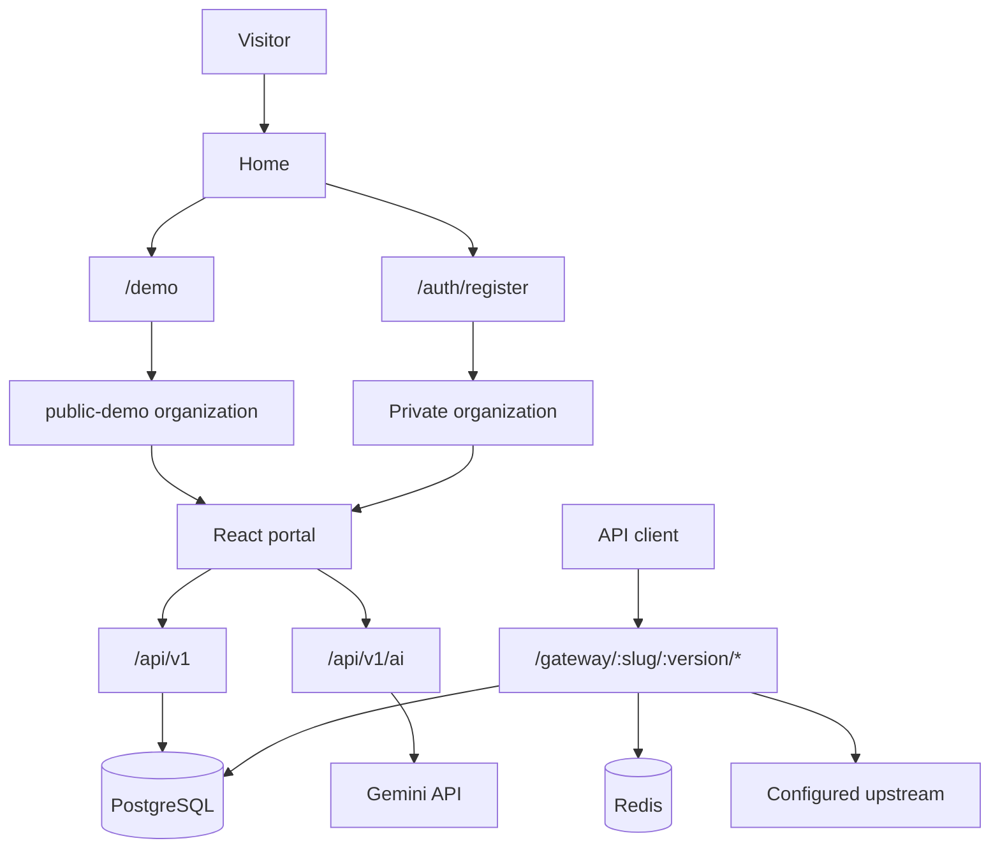

# NexGate architecture

NexGate is one Node process and one React app. PostgreSQL stores tenants, APIs, keys, and logs. Redis counts rate limits and Gemini usage, and the process falls back to memory when Redis is down.

## Access modes

Sessions are HTTP-only cookies. The JWT includes `demo: true` only for the reserved demo visitor.

| Mode | Database role | Extra rule |
| --- | --- | --- |
| Demo viewer | `DEVELOPER` on `public-demo` only | JWT `demo` blocks every management write except logout, the assistant, demo reset, and `/gateway` |
| Developer | `DEVELOPER` | Can create applications and keys. Cannot publish APIs |
| API provider | `ADMIN` | Can publish and edit APIs |
| Organization admin | `OWNER` | Can publish APIs and delete them |

Registration maps **Publish APIs** to `OWNER` and **Consume APIs** to `DEVELOPER`. The demo flag is enforced in `denyDemoMutation` before the route handler.

## Gateway

`/gateway/:apiSlug/:version/*` hashes the `X-API-Key`, checks the subscription and plan, applies the Redis rate limit, pins DNS for the upstream, and writes a request log. The demo sandbox key is derived on the server from `JWT_SECRET`. Only its hash is stored.

## Gemini

`backend/src/modules/ai` calls the Gemini REST API with the server key. Prompts are trimmed and stripped of `ng_live` / `ng_test` keys and bearer tokens. The model is `GEMINI_MODEL`. Output is parsed as JSON and checked with Zod before the client sees it.
