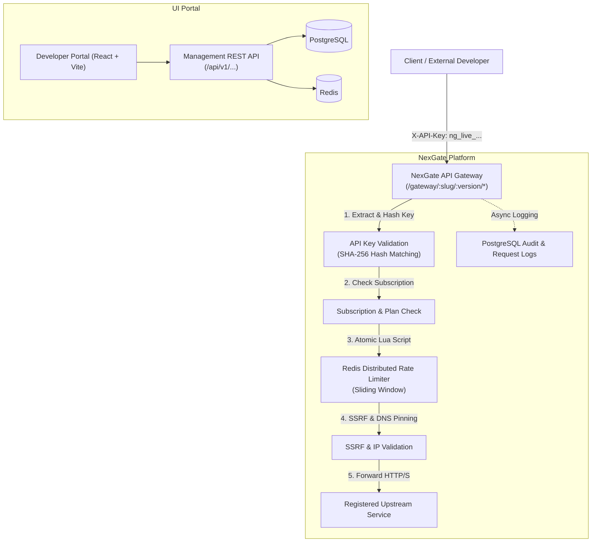

# ⚡ NexGate — API Infrastructure, Simplified.
### Production-Grade API Management Platform & Developer Gateway

NexGate is a self-service API management and developer gateway designed to unify upstream service routing, distributed rate-limiting, credential isolation, and developer consumption.

## Live deployments

| App | URL |
| --- | --- |
| Frontend | https://nex-gate-frontend.vercel.app |
| Backend | https://nex-gate-backend.vercel.app/ |

Open the frontend and choose **Instant Demo**. The API health check is https://nex-gate-backend.vercel.app/health.

---

## 🚀 Key Architectural Pillars

1. **High-Performance Gateway Proxy**
   - Live HTTP reverse proxy routing via `/gateway/:apiSlug/:version/*`
   - Real-time header sanitization, hop-by-hop stripping, and upstream forwarding
   - Sub-5ms internal gateway routing overhead
   - Upstream timeout protection (504) and bad gateway handling (502)

2. **Distributed Atomic Rate Limiting (Redis + Lua)**
   - Redis-backed sliding window counter prevents boundary spikes and race conditions
   - Transparent in-memory fallback ensures resilience if Redis connection is unavailable
   - Enforces per-minute throttling and daily/monthly quota caps
   - Full RFC-compliant headers: `RateLimit-Limit`, `RateLimit-Remaining`, `RateLimit-Reset`

3. **Multi-Tenant Security & Tenant Isolation**
   - Organization-scoped tenant boundary checks
   - Zero plaintext storage of API keys: SHA-256 one-way hashing with prefix-based index lookup
   - Full SSRF (Server-Side Request Forgery) protection validating destination IP addresses against private networks (10.0.0.0/8, 172.16.0.0/12, 192.168.0.0/16, loopbacks, link-local, and cloud metadata 169.254.169.254)
   - Secure HTTP-only cookie JWT session management

4. **Premium Dual-Theme Design System**
   - **Light Mode:** Bento-grid layouts, straight-line anchored grids, restrained shadows, warm neutral surfaces.
   - **Dark Mode:** Cinematic dark slate surfaces, electric blue & vivid neon purple accents matching the NexGate brand identity.
   - Zero theme-flash inline head initialization script.

5. **Integrated Developer Experience**
   - Live **API Request Playground** for executing real requests against the gateway
   - Real-time Response Inspector with status codes, latency in ms, and header viewer
   - Complete OpenAPI 3.0 Documentation reference
   - Searchable, paginated audit log inspection

---

## 🏛️ System Architecture



---

## 📂 Project Structure

```
api-management-portal/
├── backend/
│   ├── src/
│   │   ├── config/              # Environment (Zod), Prisma, Redis singleton
│   │   ├── middleware/          # JWT Auth, RBAC, OrgContext, RateLimiters
│   │   ├── modules/
│   │   │   ├── auth/            # Register, Login, Session cookies, Me
│   │   │   ├── organizations/   # Multi-tenant organization & membership
│   │   │   ├── apis/            # API Registry, versioning, endpoints
│   │   │   ├── applications/    # Apps, Key generation (prefix+hash), Subscriptions
│   │   │   ├── gateway/         # The Core Gateway proxy & forwarder
│   │   │   ├── analytics/       # Aggregations, KPIs, Timeseries
│   │   │   ├── requestlogs/     # Audit & gateway log inspection
│   │   │   ├── plans/           # Free, Pro, Enterprise tier controls
│   │   │   ├── webhooks/        # HMAC-SHA256 signed event delivery
│   │   │   └── mock/            # Built-in live mock upstream services
│   │   ├── utils/               # Crypto, SSRF validator, pagination
│   │   ├── app.ts               # Express assembly
│   │   └── index.ts             # Server entry point
│   ├── prisma/
│   │   ├── schema.prisma        # Complete 16-table PostgreSQL schema
│   │   └── seed.ts              # Database seed script
│   └── tests/                   # Vitest unit & integration test suite
│
├── frontend/
│   ├── src/
│   │   ├── api/                 # Axios HTTP client with interceptors
│   │   ├── components/
│   │   │   ├── layout/          # AppShell, Sidebar, TopNav
│   │   │   ├── shared/          # ThemeToggle, KpiCard
│   │   │   └── ui/              # Button, Input, Card, Badge, Dialog, EmptyState
│   │   ├── context/             # AuthContext, ThemeContext, ToastContext
│   │   ├── pages/
│   │   │   ├── auth/            # LoginPage, RegisterPage
│   │   │   ├── dashboard/       # Bento Grid KPI Dashboard (Recharts)
│   │   │   ├── apis/            # API Registry & Creator
│   │   │   ├── apps/            # Application & API Key Management
│   │   │   ├── playground/      # Interactive API Request Playground
│   │   │   ├── analytics/       # Throughput & Latency Timeseries
│   │   │   ├── requestlogs/     # Filterable Log Inspector
│   │   │   └── docs/            # OpenAPI Documentation
│   │   └── styles/              # Design tokens (globals.css, Tailwind)
│   └── public/                  # NexGate logo & favicon assets
│
└── docker-compose.yml           # PostgreSQL 16 & Redis 7 services
```

---

## 🛠️ Getting Started

### 1. Prerequisites
- **Node.js**: v18+ (tested on Node v24)
- **npm** or **pnpm**
- **Docker** (optional, for containerized PostgreSQL & Redis)

### 2. Environment Setup
```bash
# Copy template environment files
cp .env.example .env
```

### 3. Start Infrastructure (Optional)
If you have Docker installed:
```bash
docker-compose up -d
```
*Note: NexGate includes a high-performance in-memory fallback for rate limiting if Redis is offline.*

### 4. Install & Launch

```bash
# Terminal 1 — Backend
cd backend
npm install
npx prisma generate
npm run dev

# Terminal 2 — Frontend
cd frontend
npm install
npm run dev
```

Visit **http://localhost:5173**.

The home page offers two ways in:

- **Instant Demo** at `/demo` opens a read-only sample workspace. It does not use a shared administrator password.
- **Full registration** at `/auth/register` creates a private organization. Choose **Publish APIs** (owner) or **Consume APIs** (developer).

Apply the database schema, then seed local sample data:

```bash
cd backend
npx prisma db push
npm run prisma:seed
```

The seed still creates a local operator for development. Do not publish that password or reuse it on a public deployment. Visitors should use Instant Demo.

---

## 🧪 Testing the API Gateway

You can send live requests directly through the gateway to the built-in mock services:

```bash
# Current Weather Mock Endpoint via NexGate Gateway
curl -X GET "http://localhost:3000/gateway/weather-api/v1/current?city=Tokyo" \
  -H "X-API-Key: ng_live_your_generated_key_here"
```

Expected Response:
```json
{
  "location": "Tokyo",
  "temperatureC": 21,
  "condition": "Partly Cloudy",
  "humidity": 58,
  "source": "NexGate Mock Weather Upstream Service"
}
```

Response Headers:
```http
RateLimit-Limit: 60
RateLimit-Remaining: 59
RateLimit-Reset: 60
X-Gateway-Latency: 8ms
```

---

## 🛡️ Automated Verification Suite

Run the test suite in the backend directory:
```bash
cd backend
npm test
```
All test suites cover:
- Cryptographic key generation, prefix extraction, and SHA-256 hash security
- SSRF prevention, IP restriction, and cloud metadata access blocks
- Distributed atomic sliding window rate limiting
- Gateway routing, 401 missing key rejection, and health endpoints
- Demo sessions cannot create APIs, keys, or organization settings
- Gemini prompts drop API keys and bearer tokens before they are sent

---

## Instant Demo and registration

| Path | Who | What they can do |
| --- | --- | --- |
| `/demo` | Visitor, no account | Read the **NexGate Demo** organization, call the sandbox gateway, use a capped Gemini assistant |
| `/auth/register` | New account | Own a separate organization and publish or consume APIs |

Demo traffic lives on organization slug `public-demo`. Registered organizations are separate memberships. A demo session that tries to create an API, key, or webhook receives **403**. `POST /api/v1/demo/reset` deletes live demo logs and keeps the labeled sample history.

## Gemini assistant

The assistant calls Google Gemini from the backend with `GEMINI_API_KEY`. The browser never receives the key. Requests are limited per day (`DEMO_DAILY_AI_LIMIT`, `USER_DAILY_AI_LIMIT`), timed out, and retried once on a temporary Gemini failure. Documentation, error explanations, and traffic insights run only when someone asks. Examples always use the placeholder `YOUR_API_KEY`.

## Deployment

The live site is https://nex-gate-frontend.vercel.app. The API is https://nex-gate-backend.vercel.app/.

Hosting steps, environment variables, and migration notes are in [DEPLOYMENT.md](DEPLOYMENT.md). Architecture is in [ARCHITECTURE.md](ARCHITECTURE.md). HTTP routes are in [API_DOCUMENTATION.md](API_DOCUMENTATION.md).

## Known limitations

- Password reset stores a token and does not send email.
- Webhook deliveries are recorded, not pushed to subscribers.
- The public demo is one shared read-only visitor, not a private workspace per browser.
- Gemini stays disabled until `GEMINI_API_KEY` is set on the server.
